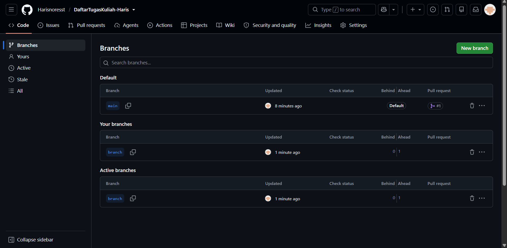
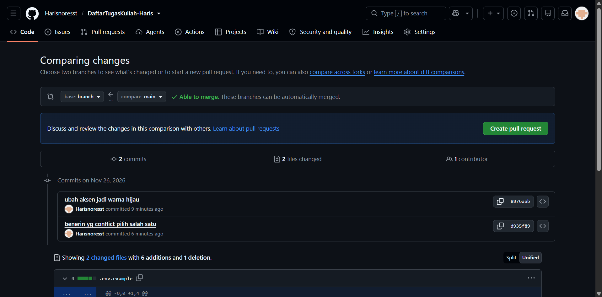
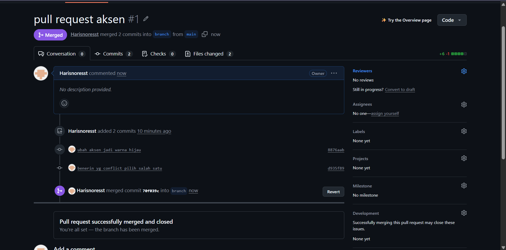
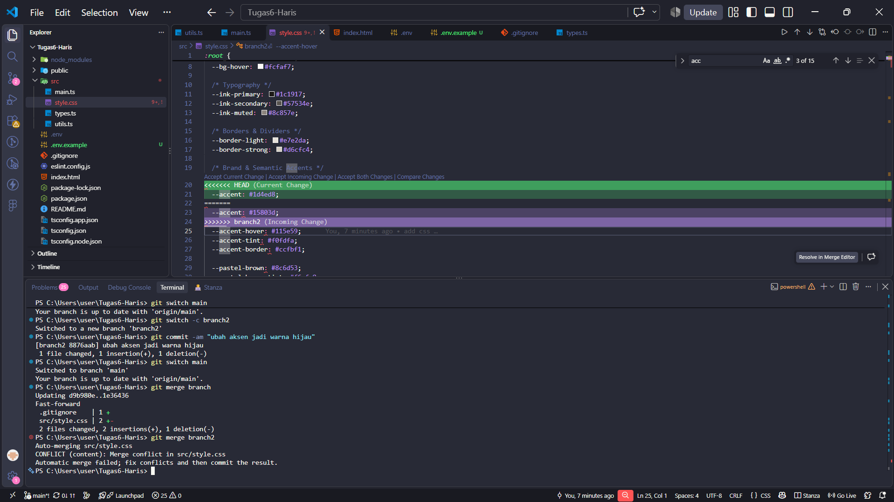
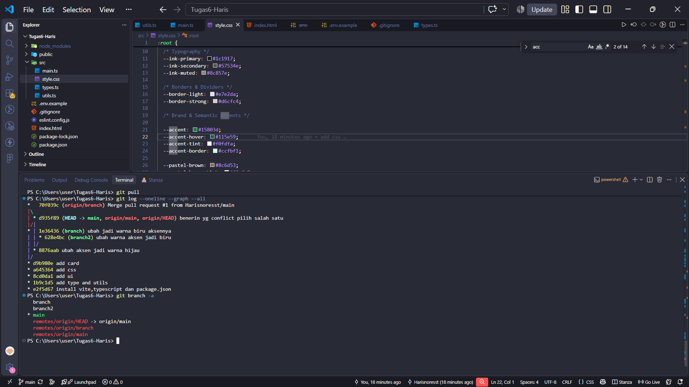

# Tugas 6 — Pengembangan Aplikasi Web

Muhammad Haris Nur Fadillah 1247050090

Project ini dibuat untuk memenuhi tugas Pertemuan 6 mata kuliah Pengembangan Aplikasi Web dengan menerapkan Git, GitHub, npm, TypeScript, dan Vite.

## Teknologi
- TypeScript
- Vite
- npm
- Git & GitHub

## Menjalankan Aplikasi

```bash
npm install
npm run dev
```

Build aplikasi:

```bash
npm run build
```

## Implementasi Git dan GitHub

Dalam pengerjaan project ini dilakukan:
- Membuat repository GitHub.
- Melakukan commit dan push perubahan.
- Membuat branch `branch` dan `branch2`.
- Melakukan merge branch ke `main`.
- Melakukan Pull Request.
- Melakukan pull dari repository remote.
- Mencoba dan menyelesaikan merge conflict.

## Screenshot Bukti Git

Screenshot berikut menunjukkan riwayat commit, branch, merge, dan hasil penyelesaian merge conflict.












